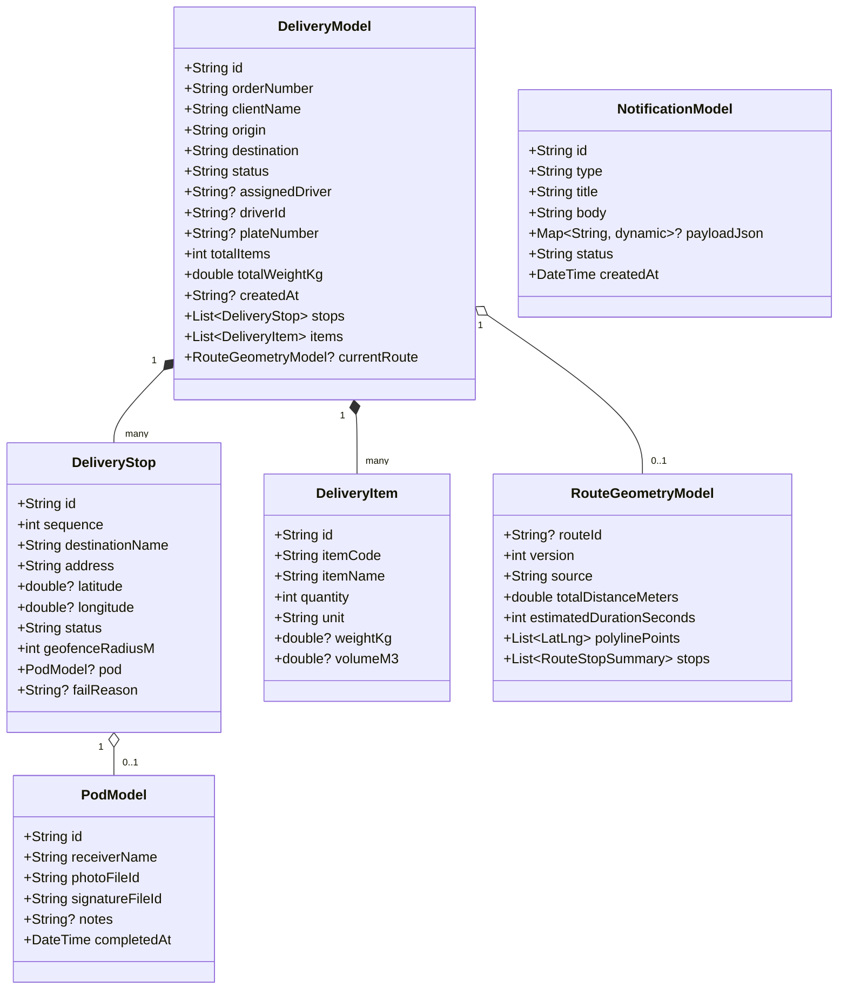
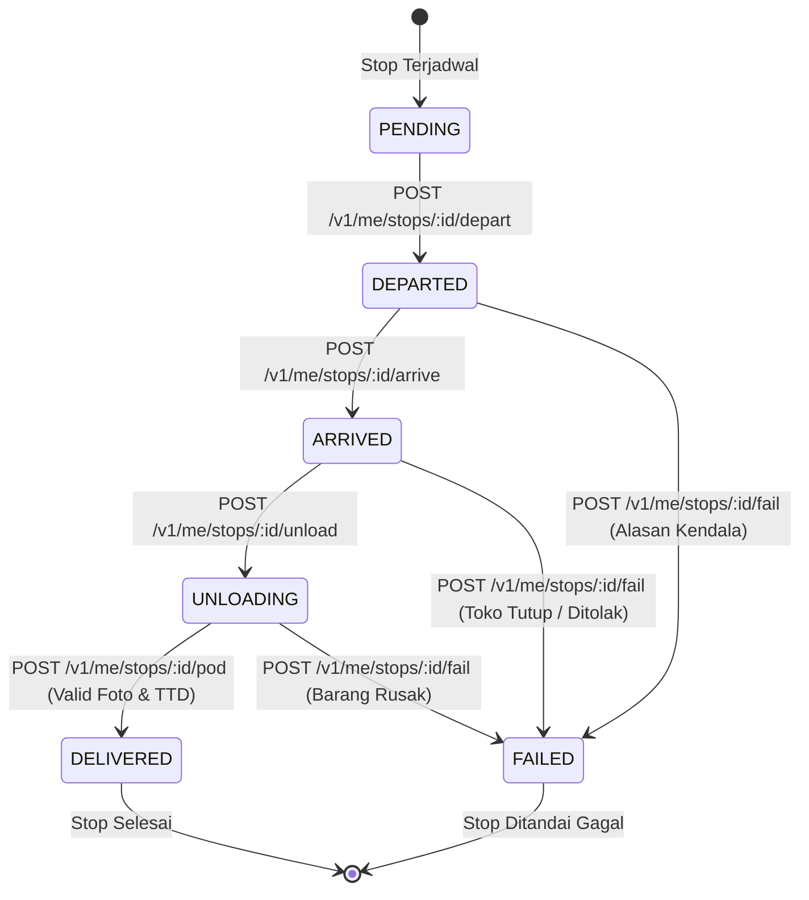
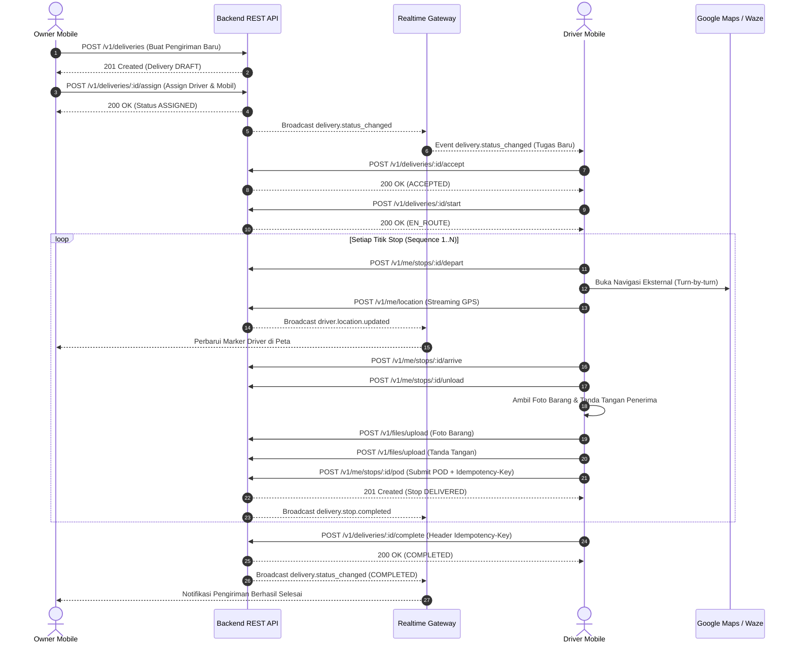

# Spesifikasi Teknis: Implementasi Penuh Frontend Mobile (Owner & Driver)

**Dokumen:** Spesifikasi Arsitektur & Teknis Frontend Mobile (Flutter)  
**ID Dokumen:** `SPEC-FE-MOB-2026-10-31`  
**Target Repositori:** `armadamobile` (`https://github.com/tirangga30/armadamobile`)  
**Backend Source of Truth:** `be-distribution-system-armada` (NestJS 10, PostgreSQL 16 + PostGIS, Redis 7, Socket.IO)  
**Tanggal:** 31 Oktober 2026  
**Status:** DRAFT SPECIFICATION FOR REVIEW  
**Penulis:** Lead Mobile Software Engineer (Flutter)

---

## 1. Ringkasan Eksekutif & Dokumen Metadata

Aplikasi mobile **Armada Distribution System** merupakan aplikasi multi-peran (Owner dan Driver) yang dibangun dengan Flutter untuk mendukung operasional distribusi logistik secara real-time, akurat, dan berketahanan tinggi di lapangan.

Saat ini fondasi dasar seperti autentikasi JWT multi-role, pelacakan GPS driver foreground, peta OpenStreetMap (OSM) dasar, dan pelaporan darurat (SOS) telah diimplementasikan. Dokumen spesifikasi ini menetapkan desain arsitektur teknis menyeluruh untuk melengkapi seluruh kapabilitas produksi yang terbagi ke dalam **4 Fase Besar**:

1. **FASE 1: Driver Granular Stop Execution & Physical Proof of Delivery (POD)**
2. **FASE 2: Visualisasi Rute Peta (Polyline) & Navigasi Eksternal**
3. **FASE 3: Manajemen Pengiriman & Penugasan Armada oleh Owner**
4. **FASE 4: Realtime Gateway (Socket.IO) & In-App Notification Center**

---

## 2. Acuan Sumber Kebenaran & Batasan Sistem (Master Constraints)

Seluruh implementasi teknis wajib mematuhi kontrak backend yang telah diaudit pada commit `840dfd6` (`be-distribution-system-armada`):

### 2.1 Konvensi Jaringan & Transport
- **Base URL REST API:** `https://armada-api.prizftm.my.id/v1` (Production) / `http://localhost:3000/v1` (Local Dev).
- **Base URL Realtime Gateway:** `wss://armada-api.prizftm.my.id/v1/realtime` (Namespace: `/v1/realtime`).
- **Standard Envelope Response:**
  ```json
  {
    "success": true,
    "data": { ... },
    "timestamp": "2026-10-31T08:00:00.000Z",
    "requestId": "UUIDv4"
  }
  ```
- **Standard Error Response:**
  ```json
  {
    "success": false,
    "error": {
      "code": "MACHINE_READABLE_CODE",
      "message": "Human-readable safe explanation",
      "requestId": "UUIDv4"
    },
    "timestamp": "2026-10-31T08:00:00.000Z"
  }
  ```
- **Header Keamanan & Idempotency:**
  - `Authorization: Bearer <access_token>` pada setiap request terotentikasi.
  - `Idempotency-Key: <UUIDv4>` pada operasi mutasi kritis:
    - Submit POD: `POST /v1/me/stops/:id/pod`
    - Selesai pengiriman: `POST /v1/deliveries/:id/complete`
    - Sinkronisasi outbox offline: `POST /v1/me/sync/outbox`
  - `x-request-id: <UUIDv4>` dilewatkan untuk tracing end-to-end.

### 2.2 Larangan Keras (Non-Negotiable Restrictions)
1. Dilarang mengarang endpoint yang tidak ada di NestJS controller backend.
2. Dilarang menyimpan file biner gambar/tanda tangan secara lokal tanpa diunggah ke backend storage (`POST /v1/files/upload`).
3. Dilarang melakukan polling REST agresif untuk posisi driver ketika Socket.IO tersedia.
4. Dilarang mengeksekusi navigasi turn-by-turn buatan sendiri; navigasi wajib menggunakan handoff ke native intent via `url_launcher` (Google Maps / Waze).

---

## 3. Standar Desain Token & Ergonomi Driver (UI/UX Pro Max)

Mengacu pada panduan desain UI/UX Pro Max untuk aplikasi lapangan mobile logistik:

### 3.1 Design Tokens
- **Primary Colors:**
  - `primaryBlue`: `#2563EB` (Blue 600 - Interaksi utama Owner & Delivery)
  - `primaryDark`: `#0F172A` (Slate 900 - Latar kontras tinggi & header)
  - `surfaceLight`: `#F8FAFC` (Slate 50 - Latar aplikasi)
  - `surfaceCard`: `#FFFFFF` (White - Permukaan kartu & bottom sheet)
- **Status Colors (WCAG AA Contrast $\ge 4.5:1$):**
  - `statusSuccess` (`DELIVERED`, `COMPLETED`): `#10B981` (Emerald 500)
  - `statusWarning` (`ASSIGNED`, `PENDING`): `#F59E0B` (Amber 500)
  - `statusInfo` (`EN_ROUTE`, `DEPARTED`): `#0284C7` (Sky 600)
  - `statusArrived` (`ARRIVED`): `#6366F1` (Indigo 500)
  - `statusUnload` (`UNLOADING`): `#8B5CF6` (Purple 500)
  - `statusDanger` (`FAILED`, `CANCELLED`): `#EF4444` (Red 500)
  - `statusEmergency` (`SOS_TRIGGERED`): `#E11D48` (Rose 600)
- **Typography Scale (Plus Jakarta Sans):**
  - Display Title: 22sp, Bold (w800), tracking -0.5
  - Section Heading: 16sp, SemiBold (w700), tracking 0
  - Body Regular: 14sp, Regular (w400), line-height 20sp
  - Body Medium / Label: 13sp, Medium (w500)
  - Caption / Metadata: 11sp, SemiBold (w600)
- **Spacing System (8dp Grid Rhythm):**
  - Grid: `4dp` (xs), `8dp` (sm), `12dp` (md), `16dp` (lg), `20dp` (xl), `24dp` (2xl), `32dp` (3xl).

### 3.2 Driver Ergonomics: One-Thumb Rule
1. **The Thumb Zone:** Seluruh tombol aksi utama lapangan (Tombol Berangkat, Tiba, Bongkar, Buka Kamera POD, Tanda Tangan, dan SOS) ditempatkan pada **area 40% bagian bawah layar**.
2. **Minimum Touch Targets:** Seluruh tombol interaktif memiliki target sentuh minimal **$48 \times 48\text{ dp}$** untuk kemudahan pengoperasian saat driver berada di dalam kabin kendaraan atau mengenakan sarung tangan kerja.
3. **Modal Bottom Sheets Standards:**
   - Sudut atas melengkung (`BorderRadius.vertical(top: Radius.circular(24))`).
   - Grab handle bar di bagian tengah atas ($36 \times 4\text{ dp}$, warna `#CBD5E1`).
   - Sticky primary action button di bagian bawah modal sheet dengan padding safe area (`MediaQuery.viewPaddingOf(context).bottom`).
   - Keyboard awareness (`viewInsets.bottom` handled by `resizeToAvoidBottomInset: true` atau dynamic padding).

---

## 4. Arsitektur Domain, Model & DTO Baru

### 4.1 Diagram Hubungan Entitas (ERD Frontend)



### 4.2 Definisi DTO Detail

#### A. File Upload & POD DTOs
```dart
/// Respon dari POST /v1/files/upload
class UploadedFileResponse {
  final String fileId;
  final String objectKey;
  final String mediaType;
  final int sizeBytes;

  UploadedFileResponse({
    required this.fileId,
    required this.objectKey,
    required this.mediaType,
    required this.sizeBytes,
  });

  factory UploadedFileResponse.fromJson(Map<String, dynamic> json) {
    return UploadedFileResponse(
      fileId: json['fileId']?.toString() ?? '',
      objectKey: json['objectKey']?.toString() ?? '',
      mediaType: json['mediaType']?.toString() ?? '',
      sizeBytes: (json['sizeBytes'] is num) ? (json['sizeBytes'] as num).toInt() : 0,
    );
  }
}

/// Payload request untuk POST /v1/me/stops/:id/pod
class SubmitPodDto {
  final String receiverName;
  final String photoFileId;
  final String signatureFileId;
  final String? notes;
  final String idempotencyKey;

  SubmitPodDto({
    required this.receiverName,
    required this.photoFileId,
    required this.signatureFileId,
    this.notes,
    required this.idempotencyKey,
  });

  Map<String, dynamic> toJson() => {
    'receiverName': receiverName,
    'photoFileId': photoFileId,
    'signatureFileId': signatureFileId,
    if (notes != null && notes!.trim().isNotEmpty) 'notes': notes!.trim(),
    'idempotencyKey': idempotencyKey,
  };
}

/// Payload request untuk POST /v1/me/stops/:id/fail
class FailStopDto {
  final String reason;
  FailStopDto({required this.reason});
  Map<String, dynamic> toJson() => {'reason': reason};
}
```

#### B. Route Optimization & Polyline DTOs
```dart
/// Model parsing geometri rute dari GET /v1/deliveries/:id/routes/current
class RouteGeometryModel {
  final String? routeId;
  final String deliveryId;
  final int version;
  final String source;
  final double totalDistanceMeters;
  final int estimatedDurationSeconds;
  final List<LatLng> polylinePoints;

  RouteGeometryModel({
    this.routeId,
    required this.deliveryId,
    required this.version,
    required this.source,
    required this.totalDistanceMeters,
    required this.estimatedDurationSeconds,
    required this.polylinePoints,
  });

  factory RouteGeometryModel.fromJson(Map<String, dynamic> json) {
    List<LatLng> points = [];
    if (json['polylineGeojson'] != null && json['polylineGeojson']['coordinates'] is List) {
      final coords = json['polylineGeojson']['coordinates'] as List;
      for (final pt in coords) {
        if (pt is List && pt.length >= 2) {
          // GeoJSON standard: [lng, lat] -> LatLng(lat, lng)
          final lng = (pt[0] as num).toDouble();
          final lat = (pt[1] as num).toDouble();
          points.add(LatLng(lat, lng));
        }
      }
    }

    return RouteGeometryModel(
      routeId: json['routeId']?.toString(),
      deliveryId: json['deliveryId']?.toString() ?? '',
      version: (json['version'] as num?)?.toInt() ?? 0,
      source: json['source']?.toString() ?? 'MANUAL',
      totalDistanceMeters: (json['totalDistanceMeters'] as num?)?.toDouble() ?? 0.0,
      estimatedDurationSeconds: (json['estimatedDurationSeconds'] as num?)?.toInt() ?? 0,
      polylinePoints: points,
    );
  }
}
```

#### C. Order Creation & Assignment DTOs
```dart
/// Payload request untuk POST /v1/deliveries
class CreateDeliveryDto {
  final String deliveryCode;
  final String? plannedStartAt;
  final List<CreateDeliveryItemDto> items;
  final List<CreateDeliveryStopDto> stops;

  CreateDeliveryDto({
    required this.deliveryCode,
    this.plannedStartAt,
    required this.items,
    required this.stops,
  });

  Map<String, dynamic> toJson() => {
    'deliveryCode': deliveryCode,
    if (plannedStartAt != null) 'plannedStartAt': plannedStartAt,
    'items': items.map((e) => e.toJson()).toList(),
    'stops': stops.map((e) => e.toJson()).toList(),
  };
}

class CreateDeliveryItemDto {
  final String itemCode;
  final String itemName;
  final int quantity;
  final String unit;
  final double? weightKg;
  final double? volumeM3;

  CreateDeliveryItemDto({
    required this.itemCode,
    required this.itemName,
    required this.quantity,
    required this.unit,
    this.weightKg,
    this.volumeM3,
  });

  Map<String, dynamic> toJson() => {
    'itemCode': itemCode,
    'itemName': itemName,
    'quantity': quantity,
    'unit': unit,
    if (weightKg != null) 'weightKg': weightKg,
    if (volumeM3 != null) 'volumeM3': volumeM3,
  };
}

class CreateDeliveryStopDto {
  final int sequence;
  final String destinationName;
  final String address;
  final double latitude;
  final double longitude;
  final int geofenceRadiusM;

  CreateDeliveryStopDto({
    required this.sequence,
    required this.destinationName,
    required this.address,
    required this.latitude,
    required this.longitude,
    this.geofenceRadiusM = 100,
  });

  Map<String, dynamic> toJson() => {
    'sequence': sequence,
    'destinationName': destinationName,
    'address': address,
    'latitude': latitude,
    'longitude': longitude,
    'geofenceRadiusM': geofenceRadiusM,
  };
}

/// Payload request untuk POST /v1/deliveries/:id/assign
class AssignDeliveryDto {
  final String driverId;
  final String vehicleId;

  AssignDeliveryDto({
    required this.driverId,
    required this.vehicleId,
  });

  Map<String, dynamic> toJson() => {
    'driverId': driverId,
    'vehicleId': vehicleId,
  };
}
```

#### D. Realtime Gateway & Notification DTOs
```dart
/// Envelope peristiwa WebSocket dari backend
class RealtimeEnvelope<T> {
  final String eventId;
  final String event;
  final int version;
  final DateTime timestamp;
  final String? correlationId;
  final Map<String, dynamic>? actor;
  final T payload;

  RealtimeEnvelope({
    required this.eventId,
    required this.event,
    required this.version,
    required this.timestamp,
    this.correlationId,
    this.actor,
    required this.payload,
  });

  factory RealtimeEnvelope.fromJson(Map<String, dynamic> json, T Function(dynamic) fromPayload) {
    return RealtimeEnvelope(
      eventId: json['eventId']?.toString() ?? '',
      event: json['event']?.toString() ?? '',
      version: (json['version'] as num?)?.toInt() ?? 1,
      timestamp: DateTime.tryParse(json['timestamp']?.toString() ?? '') ?? DateTime.now(),
      correlationId: json['correlationId']?.toString(),
      actor: json['actor'] as Map<String, dynamic>?,
      payload: fromPayload(json['payload']),
    );
  }
}
```

---

## 5. Rincian Teknis FASE 1: Driver Granular Stop Execution & Physical POD

### 5.1 Alur Transisi State Mesin Stop
Driver tidak lagi mengubah status delivery global secara instan, melainkan mengeksekusi stop demi stop sesuai urutan `sequence`:



### 5.2 Alasan Gagal Standar (Stop Failure Enum)
Saat menekan tombol *"Laporkan Kendala / Gagal"*, modal sheet menampilkan pilihan:
1. `TOKO_TUTUP`: Toko atau gudang penerima tutup/tidak beroperasi.
2. `PENERIMA_TIDAK_DAPAT_DIHUBUNGI`: Kontak person penerima tidak aktif / tidak ada di lokasi.
3. `BARANG_RUSAK`: Kemasan atau fisik koli rusak saat pemeriksaan sebelum bongkar.
4. `JALAN_TERPUTUS`: Akses jalan menuju lokasi amblas, banjir, atau perbaikan jalan.
5. `LAINNYA`: Alasan khusus dengan input teks tambahan dari driver.

### 5.3 Implementasi Fisik POD (Kamera & Kanvas TTD)
1. **Pengambilan & Kompresi Foto (`image_picker`):**
   - Kamera dibuka dengan parameter kompresi otomatis:
     ```dart
     final XFile? photo = await ImagePicker().pickImage(
       source: ImageSource.camera,
       maxWidth: 1920,
       maxHeight: 1080,
       imageQuality: 80,
     );
     ```
   - Validasi ukuran file pada client: harus $\le 5\text{ MB}$ (batas ketat backend).
   - Menampilkan thumbnail preview foto dengan opsi retake sebelum submit.
2. **Kanvas Tanda Tangan Digital (`signature`):**
   - Widget `Signature` dengan controller:
     ```dart
     final SignatureController _sigController = SignatureController(
       penStrokeWidth: 3.0,
       penColor: const Color(0xFF0F172A),
       exportBackgroundColor: Colors.white,
     );
     ```
   - Tombol *Hapus / Bersihkan Kanvas* jika penerima ingin mengulang tanda tangan.
   - Pengecekan `_sigController.isNotEmpty` sebelum submit.
   - Export ke byte PNG via `await _sigController.toPngBytes()`.
3. **Unggah Multipart & Submit POD:**
   - Foto dikirim via `POST /v1/files/upload` (multipart key: `file`) $\rightarrow$ dapat `photoFileId`.
   - Tanda tangan PNG dikirim via `POST /v1/files/upload` (multipart key: `file`, `filename: "signature.png"`) $\rightarrow$ dapat `signatureFileId`.
   - Payload `SubmitPodDto` dikirimkan ke `POST /v1/me/stops/:id/pod` dengan header:
     `Idempotency-Key: <UUIDv4>`.
   - Status stop diperbarui menjadi `DELIVERED`. Jika seluruh stop telah berstatus `DELIVERED` atau `FAILED`, aplikasi otomatis memanggil `POST /v1/deliveries/:id/complete` dengan header `Idempotency-Key`.

---

## 6. Rincian Teknis FASE 2: Visualisasi Rute Peta (Polyline) & Navigasi Eksternal

### 6.1 Rendering Polyline pada `ArmadaOsmMap`
1. Endpoint `GET /v1/deliveries/:id/routes/current` mengembalikan data rute aktif termasuk `polylineGeojson`.
2. Format `polylineGeojson.coordinates` merupakan array pasang `[longitude, latitude]`. Dikonversi ke `LatLng(latitude, longitude)` untuk Flutter Map.
3. Layer `PolylineLayer` ditambahkan pada `ArmadaOsmMap`:
   ```dart
   Polyline(
     points: routePoints,
     strokeWidth: 4.5,
     color: AppTheme.primaryBlue,
     borderColor: const Color(0xFF1E40AF),
     borderStrokeWidth: 1.5,
   )
   ```

### 6.2 Marker Titik Stop Bernomor
1. Tiap stop memiliki visual marker melingkar berisi nomor urut sequence (`1`, `2`, `3`, ...).
2. Warna background marker berubah dinamis:
   - Abu-abu (`#94A3B8`): `PENDING`
   - Biru Laut (`#0284C7`): `DEPARTED` (tujuan aktif berikutnya)
   - Ungu (`#8B5CF6`): `ARRIVED` / `UNLOADING`
   - Hijau Zamrud (`#10B981`): `DELIVERED`
   - Merah (`#EF4444`): `FAILED`
3. Tap pada marker menampilkan kartu ringkasan toko tujuan di atas peta.

### 6.3 External Navigation Handoff (`url_launcher`)
Pada kartu tujuan stop aktif, terdapat tombol *"Navigasi ke Lokasi"*. Ketika diklik:
1. Menyusun URI eksternal:
   - Primary: `https://www.google.com/maps/dir/?api=1&destination=${stop.latitude},${stop.longitude}`
   - Fallback Native Intent (Android): `geo:${stop.latitude},${stop.longitude}?q=${stop.latitude},${stop.longitude}(${Uri.encodeComponent(stop.destinationName)})`
   - Waze option: `https://waze.com/ul?ll=${stop.latitude},${stop.longitude}&navigate=yes`
2. Meluncurkan aplikasi peta dengan `LaunchMode.externalApplication`:
   ```dart
   final uri = Uri.parse('https://www.google.com/maps/dir/?api=1&destination=${stop.latitude},${stop.longitude}');
   if (await canLaunchUrl(uri)) {
     await launchUrl(uri, mode: LaunchMode.externalApplication);
   }
   ```

### 6.4 Pemilihan & Evaluasi Rute (Owner & Driver)
- Tombol *"Rekomendasi Rute Terbaik (2-Opt TSP)"* memanggil `POST /v1/deliveries/:id/routes/recommend`.
- Menampilkan perbandingan jarak total (meter) dan estimasi durasi tempuh (menit) antara rute saat ini vs rekomendasi 2-Opt.
- Tombol *"Terapkan Rute Rekomendasi"* memanggil `POST /v1/deliveries/:id/routes/select` dengan payload `SelectRouteDto` dan memperbarui polyline di peta secara instan.

---

## 7. Rincian Teknis FASE 3: Manajemen Pengiriman & Penugasan Armada oleh Owner

### 7.1 Form Pembuatan Pengiriman Baru (Create Delivery)
Owner dapat membuat order distribusi baru melalui formulir terstruktur:
1. **Header Order:** Nomor DO / Surat Jalan (auto-generate atau manual input dengan format `DO-YYYY-XXXX`), tanggal rencana kirim (`plannedStartAt`).
2. **Cargo Items Builder:**
   - Tambah baris barang: Nama barang, kode SKU/item, jumlah koli, satuan unit (`KOLI`, `DUS`, `PAIL`, `KG`), estimasi berat per unit.
   - Total koli dan total berat dihitung otomatis secara reaktif.
3. **Multi-Stop Destination Builder:**
   - Tambah baris toko/tujuan: Nama outlet, alamat lengkap, koordinat (Latitude & Longitude), radius geofence (default 100 meter).
   - Reordering stop sequence secara drag-and-drop atau urutan bertingkat.
4. **Submit Order:** Mengirim `POST /v1/deliveries` $\rightarrow$ status awal pengiriman menjadi `DRAFT`.

### 7.2 Modal Penugasan Driver & Kendaraan (Assign Delivery)
Owner menugaskan armada pada delivery berstatus `DRAFT` atau `ASSIGNED`:
1. **Daftar Driver & Kendaraan:**
   - Driver diambil dari data aktif organisasi via `GET /v1/fleet/locations`.
   - Kendaraan aktif teridentifikasi melalui `plateNumber` dan `activeVehicleId`.
2. **Validasi Kapasitas Muatan (Pre-flight Capacity Check):**
   - Aplikasi membandingkan total berat kargo pengiriman ($\sum \text{weightKg}$) terhadap kapasitas kendaraan target (`capacityWeightKg`).
   - Jika muatan kargo melebihi kapasitas maksimum armada, form menampilkan peringatan merah tebal (*Overload Alert*) dan mencegah tombol assign ditekan tanpa konfirmasi paksa.
3. **Submit Penugasan:** Memanggil `POST /v1/deliveries/:id/assign` dengan payload `{ driverId, vehicleId }` $\rightarrow$ status delivery berubah menjadi `ASSIGNED` dan tercatat di audit log.

### 7.3 Tampilan Detail Pengiriman & Riwayat Audit Log
Halaman detail pengiriman menyajikan:
- Status badge hidup dengan warna semantik.
- Nama driver terpilih, nomor plat kendaraan, dan tautan panggilan/chat.
- Daftar item barang dan status pemenuhan.
- Timeline audit aktivitas pengiriman (`DELIVERY_CREATED`, `DELIVERY_ASSIGNED`, `ROUTE_SELECTED`, `STOP_DEPARTED`, `STOP_DELIVERED`, dsb.).

---

## 8. Rincian Teknis FASE 4: Realtime Gateway (Socket.IO) & In-App Notification Center

### 8.1 Arsitektur SocketService Client (`socket_io_client`)
Koneksi WebSocket diinisialisasi melalui singleton/provider service:
- **URL Koneksi:** `${AppConfig.wsBaseUrl}/v1/realtime`
- **Konfigurasi Handshake:**
  ```dart
  final socket = IO.io(
    '${AppConfig.wsBaseUrl}/v1/realtime',
    IO.OptionBuilder()
      .setTransports(['websocket'])
      .disableAutoConnect()
      .setAuth({'token': 'Bearer $accessToken'})
      .enableReconnection()
      .setReconnectionDelay(2000)
      .setReconnectionAttempts(10)
      .build(),
  );
  ```
- **Room Subscriptions:**
  - Saat Owner membuka Fleet Map: `socket.emit('join_room', {'room': 'fleet:monitoring'})`.
  - Saat Owner atau Driver membuka Detail Pengiriman: `socket.emit('join_room', {'room': 'delivery:$deliveryId'})`.
  - Saat keluar dari layar: `socket.emit('leave_room', ...)`.

### 8.2 Event Streaming & Handler Reaktif
1. **`driver.location.updated`:**
   - Menerima envelope berisi `{ driverId, latitude, longitude, speedMps, headingDeg, recordedAt }`.
   - Memperbarui koordinat marker driver di peta secara langsung tanpa me-refresh seluruh view (*smooth position interpolation*).
2. **`delivery.status_changed`:**
   - Menerima perubahan status delivery (`ASSIGNED`, `ACCEPTED`, `EN_ROUTE`, `COMPLETED`, dll.).
   - Memperbarui status kartu tugas driver dan tabel monitoring owner secara seketika.
3. **`emergency.triggered`:**
   - Menerima payload SOS driver `{ emergencyId, driverId, driverName, latitude, longitude, emergencyType }`.
   - Memunculkan **SOS Emergency Banner** merah terang dengan getaran (haptic feedback) dan tombol pintas navigasi ke lokasi darurat driver.

### 8.3 Pusat Notifikasi (In-App Notification Center)
1. **Pengambilan Notifikasi:** `GET /v1/notifications?limit=20&offset=0`.
2. **Tanda Telah Dibaca:** `PATCH /v1/notifications/:id/read`.
3. **Pemberitahuan Badging:** Menampilkan badge jumlah notifikasi belum dibaca (*unread count badge*) pada AppBar dan navigation tab.

---

## 9. Penanganan Error, Validasi Input & Ketahanan Offline

### 9.1 Matriks Penanganan Error (Standard Error Mapping)

| Kode Error Backend | HTTP Status | Penanganan Frontend Mobile |
| :--- | :---: | :--- |
| `UNAUTHORIZED` / `INVALID_TOKEN` | 401 | Hapus token lokal dari `SecureStorage`, arahkan user kembali ke `LoginScreen`. |
| `RESOURCE_FORBIDDEN` | 403 | Tampilkan SnackBar peringatan akses ditolak (Driver tidak berhak membuka order milik driver lain). |
| `DELIVERY_NOT_FOUND` | 404 | Berikan tampilan Empty State dan tombol refresh data. |
| `INVALID_STATE_TRANSITION` | 409 | Informasikan status pengiriman telah berubah oleh entitas lain; muat ulang data terbaru. |
| `ACTIVE_EMERGENCY_EXISTS` | 409 | Tampilkan status darurat yang sedang aktif tanpa membuat entri SOS ganda. |
| `DUPLICATE_DELIVERY_CODE` | 400 | Tampilkan error inline pada field input nomor DO agar diubah. |
| `FILE_TOO_LARGE` | 413 | Beritahu bahwa foto melebihi 5 MB dan minta pengambilan ulang dengan resolusi lebih hemat. |
| `NETWORK_OFFLINE` | 503 / None | Masukkan aksi ke pending queue offline jika memungkinkan, tampilkan banner koneksi offline. |

### 9.2 Skema Idempotency
Seluruh aksi mutasi stop POD dan complete delivery menyertakan `Idempotency-Key` bertipe UUID v4 unik yang dihasilkan sebelum request dikirim. Jika terjadi *network drop* saat pengiriman, pengulangan request (retry) akan mengirimkan UUID yang sama sehingga backend mengembalikan respon tersimpan tanpa menduplikasi data.

---

## 10. Diagram Alur Sistem (Mermaid Flowcharts)

### 10.1 Alur Pengiriman Lengkap (End-to-End Delivery Flow)



---

## 11. Kesimpulan & Status Dokumen

Dokumen spesifikasi ini telah memetakan kebutuhan arsitektur mobile Flutter secara komprehensif, sesuai dengan kontrak resmi backend NestJS `be-distribution-system-armada`, standar desain UI/UX Pro Max, dan prinsip rekayasa perangkat lunak enterprise.

Dokumen ini menjadi acuan tunggal dalam penyusunan implementation plan teknis di `docs/superpowers/plans/2026-10-31-fe-mobile-full-implementation-plan.md`.
