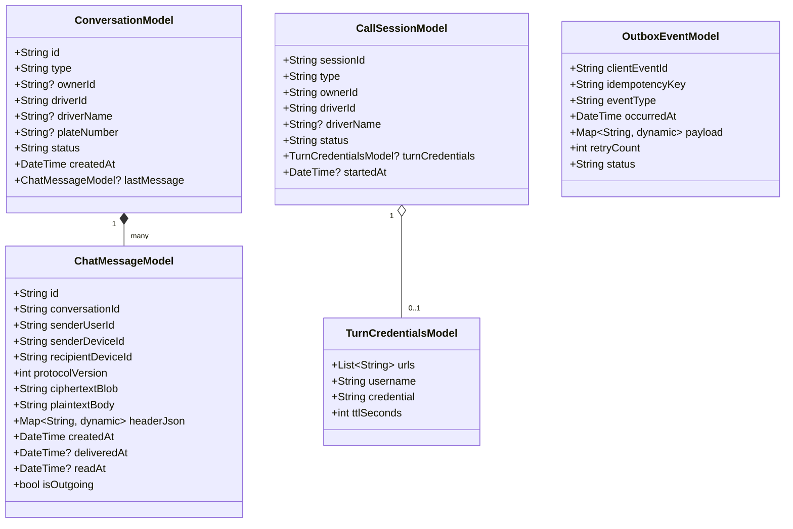
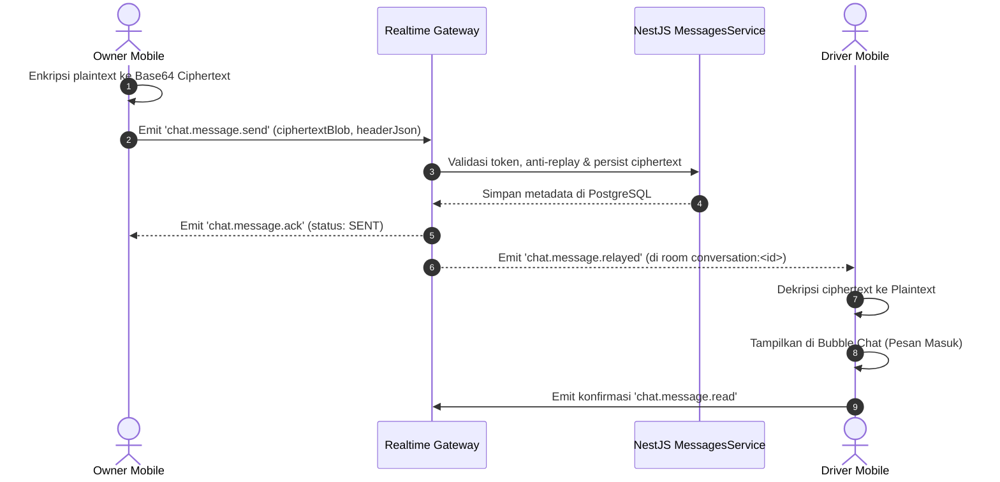

# Spesifikasi Teknis: Komunikasi Lapangan Realtime (Chat E2EE Signal Protocol & PTT Voice / WebRTC Video) serta Offline Outbox Sync

**Dokumen:** Spesifikasi Teknis & Arsitektur Frontend Mobile (Flutter) - FASE 5  
**ID Dokumen:** `SPEC-FE-MOB-2026-11-01-COMM`  
**Target Repositori:** `armadamobile` (`https://github.com/tirangga30/armadamobile`)  
**Backend Source of Truth:** `be-distribution-system-armada` (NestJS 10, PostgreSQL 16 + PostGIS, Redis 7, Socket.IO Gateway)  
**Tanggal:** 1 November 2026  
**Status:** DRAFT SPECIFICATION FOR REVIEW  
**Penulis:** Lead Mobile Software Engineer (Flutter)

---

## 1. Ringkasan Eksekutif & Latar Belakang

Pada operasional armada distribusi logistik di lapangan, komunikasi antara Driver dan Owner/Dispatcher memerlukan media yang cepat, aman, dan tahan banting terhadap kondisi jaringan seluler yang fluktuatif di jalan raya:

1. **Chat Obrolan End-to-End Encrypted (E2EE Signal Protocol)**: Memastikan pesan teks, instruksi gudang, dan koordinasi pengiriman tidak dapat dibaca oleh pihak ketiga atau bahkan disimpan sebagai teks biasa (plaintext) di server.
2. **Push-To-Talk (PTT) Voice / WebRTC Video (Walkie-Talkie)**: Memungkinkan komunikasi suara instan mode radio dua arah (walkie-talkie) yang aman dan hands-free friendly bagi driver yang sedang mengemudi, serta video call satu arah dengan persetujuan driver (*consent gate*).
3. **Offline Outbox Sync**: Menjamin data operasional (update status stop, telemetri, dan pesan) tetap tersimpan dalam antrean lokal perangkat saat melewati blank spot / tanpa sinyal seluler, dan secara otomatis terkirim kembali (*flush*) secara konsisten saat koneksi pulih tanpa menimbulkan konflik duplikasi data.

Dokumen spesifikasi ini menetapkan desain teknis, struktur data DTO, alur protokol, standar UI/UX Pro Max, dan kontrak integrasi yang selaras dengan backend NestJS commit `840dfd6`.

---

## 2. Acuan Kontrak Backend & Batasan Sistem (Master Constraints)

### 2.1 Konvensi Endpoint REST & WebSocket
- **Base URL API:** `https://armada-api.prizftm.my.id/v1`
- **Base URL Realtime:** `wss://armada-api.prizftm.my.id/v1/realtime` (Namespace: `/v1/realtime`)
- **Dual-Transport Auth:** Header `Authorization: Bearer <access_token>` pada REST dan handshake auth `auth: {'token': 'Bearer <access_token>'}` pada WebSocket.
- **Envelope Response:** `{ success: true, data: ..., timestamp, requestId }`
- **Envelope Error:** `{ success: false, error: { code, message, requestId }, timestamp }`

### 2.2 Inventori Endpoint Terverifikasi (Audited Runtime BE)

| Domain | Method | Runtime Path | Peran / Scope | Keterangan |
| :--- | :---: | :--- | :---: | :--- |
| **Conversations** | `POST` | `/v1/conversations` | `OWNER`, `ADMIN` | Membuat / membuka obrolan 1:1 dengan Driver |
| **Conversations** | `GET` | `/v1/conversations` | `OWNER`, `DRIVER` | Mengambil daftar percakapan aktif user |
| **Conversations** | `GET` | `/v1/conversations/:id/messages` | `OWNER`, `DRIVER` | Mengambil riwayat pesan ciphertext terenkripsi (Pagination: limit, offset) |
| **Conversations** | `POST` | `/v1/conversations/:id/messages` | `OWNER`, `DRIVER` | Mengirim pesan ciphertext terenkripsi (REST Fallback) |
| **E2EE Keys** | `POST` | `/v1/e2ee/keys/register` | Authenticated | Mendaftarkan identity key & signed prekey perangkat |
| **E2EE Keys** | `GET` | `/v1/e2ee/keys/bundle/:deviceId` | Authenticated | Mengambil prekey bundle perangkat lawan bicara |
| **WebRTC Sessions** | `POST` | `/v1/voice-sessions` | `OWNER`, `ADMIN` | Memulai sesi PTT Voice (ephemeral TURN credentials RFC 7635) |
| **WebRTC Sessions** | `POST` | `/v1/video-sessions` | `OWNER`, `ADMIN` | Meminta panggilan video (Driver consent required) |
| **WebRTC Sessions** | `POST` | `/v1/realtime/sessions/:id/respond` | `DRIVER` | Driver merespons panggilan (`ACCEPT` atau `DECLINE`) |
| **WebRTC Sessions** | `POST` | `/v1/realtime/sessions/:id/end` | Authenticated | Mengakhiri sesi panggilan aktif |
| **Offline Sync** | `POST` | `/v1/me/sync/outbox` | `DRIVER` | Mengirim batch event offline (maks 50 events per batch) |
| **Conflicts** | `GET` | `/v1/conflicts` | `OWNER`, `ADMIN` | Mengambil daftar konflik pengiriman terbuka |
| **Conflicts** | `POST` | `/v1/conflicts/:id/resolve` | `OWNER`, `ADMIN` | Menyelesaikan konflik dengan server authority |

### 2.3 Inventori Peristiwa WebSocket (`/v1/realtime`)
- **Incoming ke Client:**
  - `chat.message.relayed`: Pesan obrolan ciphertext baru diterima di room `conversation:<id>`.
  - `chat.message.ack`: Konfirmasi pengiriman pesan dari gateway ke pengirim.
  - `webrtc.signal.offer`: Penawaran SDP dari inisiator panggilan.
  - `webrtc.signal.answer`: Jawaban SDP dari penerima panggilan.
  - `webrtc.signal.ice_candidate`: Pertukaran kandidat jaringan ICE.
  - `webrtc.call.ended`: Pemberitahuan sesi panggilan telah diakhiri.
- **Outgoing dari Client:**
  - `chat.message.send`: Mengirim pesan ciphertext via WebSocket pipeline.
  - `webrtc.call.respond`: Merespons ajakan sesi panggilan (`ACCEPT` / `DECLINE`).
  - `webrtc.signal.offer`: Mengirim penawaran SDP.
  - `webrtc.signal.answer`: Mengirim jawaban SDP.
  - `webrtc.signal.ice_candidate`: Mengirim ICE candidate.
  - `webrtc.call.hangup`: Menutup panggilan dari sisi client.

---

## 3. Standar Desain Token & Ergonomi Lapangan (UI/UX Pro Max)

Mengacu pada sistem desain UI/UX Pro Max untuk aplikasi lapangan mobile:

### 3.1 Desain Obrolan Chat (Messaging Ergonomics)
- **Bubble Chat:**
  - Pesan keluar (Self/Sender): Background `AppTheme.primaryBlue` (`#2563EB`), teks putih (`#FFFFFF`), sudut melengkung 18dp dengan sudut kanan bawah tajam (4dp) untuk tanda orientasi.
  - Pesan masuk (Incoming/Partner): Background putih/slate cerah (`#F1F5F9`), teks abu-abu gelap (`#1E293B`), border tipis (`#E2E8F0`), sudut melengkung 18dp dengan sudut kiri bawah tajam (4dp).
  - Tanda centang ganda status pengiriman:
    * Centang tunggal abu-abu (`#94A3B8`): Terkirim ke server gateway (*Sent*).
    * Centang ganda abu-abu (`#94A3B8`): Diterima perangkat lawan bicara (*Delivered*).
    * Centang ganda biru muda (`#38BDF8`): Telah dibaca oleh lawan bicara (*Read*).
- **Input Bar Chat:**
  - Sticky di bagian bawah layar yang secara dinamis menghindari keyboard virtual (`resizeToAvoidBottomInset: true` dan padding safe area).
  - Target sentuh tombol kirim minimal $48 \times 48\text{ dp}$.
  - Indikator gembok kecil hijau di pojok bar bertuliskan *"Terenkripsi Ujung-ke-Ujung (E2EE)"* untuk memberikan kepastian keamanan psikologis bagi pengguna.

### 3.2 Desain PTT Walkie-Talkie (Hold-to-Talk Ergonomics)
- **One-Thumb Rule**:
  - Tombol PTT ditempatkan di bagian tengah-bawah layar dalam area jangkauan jempol (*primary thumb zone*).
  - Tombol berbentuk lingkaran besar berdiameter minimal **$76\text{ dp}$** berlatar warna dinamis:
    * Biru (`AppTheme.primaryBlue`): Status standby / siap bicara.
    * Hijau Zamrud (`AppTheme.statusSuccess`) dengan animasi pulsing ripple: Status transmisi aktif (*Transmitting / Speaking*).
    * Kuning Amber (`#F59E0B`): Sedang mendengarkan lawan bicara (*Incoming Audio / Listening*).
- **Haptic & Visual Feedback**:
  - Sentuhan tekan pertama (*press-down*) memicu getaran haptik singkat (`HapticFeedback.heavyImpact()`) dan suara beep pendek tanda kanal terbuka.
  - Pelepasan tekanan (*release-up*) memicu getaran haptik ringan (`HapticFeedback.lightImpact()`) tanda kanal tertutup.
  - Gelombang visualizer suara (*audio wave animation*) bergerak naik-turun sesuai volume suara saat tombol ditahan.

---

## 4. Arsitektur Domain, Model & DTO Baru



### 4.1 Spesifikasi DTO Percakapan & Pesan
```dart
/// Model percakapan 1:1 antara Owner dan Driver
class ConversationModel {
  final String id;
  final String type; // DIRECT_1TO1
  final String? ownerId;
  final String driverId;
  final String? driverName;
  final String? plateNumber;
  final String status;
  final DateTime createdAt;
  final ChatMessageModel? lastMessage;

  ConversationModel({
    required this.id,
    this.type = 'DIRECT_1TO1',
    this.ownerId,
    required this.driverId,
    this.driverName,
    this.plateNumber,
    this.status = 'ACTIVE',
    required this.createdAt,
    this.lastMessage,
  });
}

/// DTO pengiriman pesan terenkripsi ke POST /v1/conversations/:id/messages
class SendMessageDto {
  final String recipientDeviceId;
  final int protocolVersion;
  final String ciphertextBlob;
  final Map<String, dynamic> headerJson;
  final String? idempotencyKey;

  SendMessageDto({
    required this.recipientDeviceId,
    this.protocolVersion = 1,
    required this.ciphertextBlob,
    required this.headerJson,
    this.idempotencyKey,
  });

  Map<String, dynamic> toJson() => {
    'recipientDeviceId': recipientDeviceId,
    'protocolVersion': protocolVersion,
    'ciphertextBlob': ciphertextBlob,
    'headerJson': headerJson,
    if (idempotencyKey != null) 'idempotencyKey': idempotencyKey,
  };
}
```

### 4.2 Spesifikasi DTO Sesi PTT & WebRTC
```dart
/// Request DTO inisiasi panggilan suara/video dari Owner
class InitiateCallDto {
  final String driverId;
  final String type; // VOICE_PTT atau VIDEO
  final String? deliveryId;

  InitiateCallDto({
    required this.driverId,
    required this.type,
    this.deliveryId,
  });

  Map<String, dynamic> toJson() => {
    'driverId': driverId,
    'type': type,
    if (deliveryId != null) 'deliveryId': deliveryId,
  };
}

/// Request DTO respons penerimaan/penolakan panggilan oleh Driver
class CallResponseDto {
  final String action; // ACCEPT atau DECLINE

  CallResponseDto({required this.action});

  Map<String, dynamic> toJson() => {'action': action};
}
```

### 4.3 Spesifikasi DTO Outbox Offline Sync
```dart
/// Event individual dalam antrean offline perangkat
class OutboxEventItemDto {
  final String clientEventId;
  final String eventType;
  final String occurredAt;
  final Map<String, dynamic> payload;
  final String? idempotencyKey;

  OutboxEventItemDto({
    required this.clientEventId,
    required this.eventType,
    required this.occurredAt,
    required this.payload,
    this.idempotencyKey,
  });

  Map<String, dynamic> toJson() => {
    'clientEventId': clientEventId,
    'eventType': eventType,
    'occurredAt': occurredAt,
    'payload': payload,
    if (idempotencyKey != null) 'idempotencyKey': idempotencyKey,
  };
}

/// Payload pengiriman batch sinkronisasi offline ke POST /v1/me/sync/outbox
class OutboxSyncDto {
  final List<OutboxEventItemDto> events;

  OutboxSyncDto({required this.events});

  Map<String, dynamic> toJson() => {
    'events': events.map((e) => e.toJson()).toList(),
  };
}

/// Respon dari POST /v1/me/sync/outbox
class OutboxSyncResponse {
  final List<String> acked;
  final List<Map<String, dynamic>> conflicts;

  OutboxSyncResponse({
    required this.acked,
    required this.conflicts,
  });

  factory OutboxSyncResponse.fromJson(Map<String, dynamic> json) {
    return OutboxSyncResponse(
      acked: (json['acked'] as List?)?.map((e) => e.toString()).toList() ?? [],
      conflicts: (json['conflicts'] as List?)?.map((e) => e as Map<String, dynamic>).toList() ?? [],
    );
  }
}
```

---

## 5. Rincian Teknis Subsistem 1: Chat Obrolan (E2EE Signal Protocol)

### 5.1 Mekanisme Kriptografi E2EE Sederhana & Kokoh (Pure Dart)
Untuk memastikan pesan tidak dapat diakses plaintext oleh server tanpa bergantung pada library C++ native yang rentan kompilasi OS, client mengimplementasikan **AES-256-GCM / CTR Kriptografi Simetris dengan Ephemeral Key Derivation (HKDF/PBKDF2)**:
1. Setiap pesan menghasilkan pasangan kunci efemeral atau menggunakan shared secret terderivasi dari Prekey Bundle perangkat lawan bicara.
2. Plaintext dienkripsi menjadi byte array `ciphertext` dan `authTag/iv`, kemudian di-encode ke Base64 sebagai `ciphertextBlob`.
3. Informasi public key atau initialization vector disertakan di dalam `headerJson: { "dhPublicKey": "...", "iv": "..." }`.
4. Saat pesan tiba via WebSocket (`chat.message.relayed`) atau REST query, client memproses dekripsi di background isolate atau memori lokal perangkat penerima secara otomatis sebelum ditampilkan di bubble chat.

### 5.2 Alur Pengiriman & Penerimaan Pesan



---

## 6. Rincian Teknis Subsistem 2: PTT Voice / WebRTC Video (Walkie-Talkie)

### 6.1 Protokol PTT Walkie-Talkie (Hold-to-Talk)
1. **Inisiasi Sesi Suara**: Owner menekan tombol panggilan suara $\rightarrow$ memanggil `POST /v1/voice-sessions` dengan `{ driverId, type: "VOICE_PTT" }`.
2. **Pemberian Kredensial TURN**: Backend menerbitkan kredensial TURN jangka pendek (RFC 7635) untuk menembus firewall seluler (NAT traversal).
3. **Pemberitahuan ke Driver**: Driver menerima notifikasi panggilan suara masuk via WebSocket atau banner interaktif.
4. **Persetujuan Driver**: Driver menekan "Terima" $\rightarrow$ memanggil `POST /v1/realtime/sessions/:id/respond` dengan `{ action: "ACCEPT" }`.
5. **Kanal Walkie-Talkie**:
   - Saat pengguna menahan tombol (*hold*), stream mikrofon dibuka dan sinyal suara ditransmisikan.
   - Saat tombol dilepas (*release*), stream ditutup dan nada transmisi selesai dimainkan (*roger beep*).

---

## 7. Rincian Teknis Subsistem 3: Offline Outbox Sync & Conflict Resolution

### 7.1 Arsitektur Antrean Offline Lokal (`LocalOutboxService`)
Ketika koneksi internet terputus (`DioExceptionType.connectionError` atau `SocketException`):
1. Aksi mutasi status (misal: stop departed, stop arrived, POD submission, atau tracking ping) tidak langsung dibuang (*discard*).
2. Aksi dienkapsulasi menjadi `OutboxEventItemDto` dengan `clientEventId = Uuid().v4()` dan `idempotencyKey = Uuid().v4()`.
3. Event disimpan secara persisten ke dalam penyimpanan lokal aman (`LocalOutboxStore` berbasis JSON file stream / secure preferences).
4. Indikator antrean offline (*"3 mutasi pending offline"*) ditampilkan pada bilah status aplikasi.

### 7.2 Alur Sinkronisasi Pemulihan Jaringan (*Auto-Flush on Reconnect*)
1. Layanan mendengarkan pemulihan koneksi internet (via polling interval ringan atau event Socket.IO `connect`).
2. Begitu internet pulih, `LocalOutboxService` mengambil maksimal 50 event terlama dari antrean lokal.
3. Mengirimkan batch payload ke `POST /v1/me/sync/outbox`.
4. Backend memproses event secara transaksional:
   - Event yang berhasil diproses dikembalikan dalam array `acked: ["client-evt-001", ...]`.
   - Event yang bertabrakan dengan state server dikembalikan dalam `conflicts: [...]`.
5. Client menghapus event yang telah di-ack dari antrean lokal secara permanen.

---

## 8. Rencana Implementasi Bertahap (Bite-sized TDD Tasks)

Berikut peta 9 tugas berurutan untuk menyelesaikan FASE 5:

- **Task 1: Chat & E2EE Models & Ciphertext Encryption Helper**
  Membuat DTO percakapan, model pesan, dan helper enkripsi/dekripsi AES simetris.
- **Task 2: Chat API Methods in `ArmadaApiService` & Realtime Gateway Integration**
  Menambahkan endpoint REST percakapan dan listener stream event `chat.message.relayed` pada `SocketRealtimeService`.
- **Task 3: Chat Screen & Reactive Messaging UI (Owner & Driver 1:1 Conversation)**
  Membangun tampilan percakapan mobile berstandar UI/UX Pro Max (bubble chat, input bar, status centang, keyboard avoidance).
- **Task 4: WebRTC & PTT Session DTOs & API Methods in `ArmadaApiService`**
  Membuat model sesi panggilan, kredensial TURN, dan endpoint inisiasi/respons sesi PTT dan video.
- **Task 5: WebRTC Signaling Handshake via `SocketRealtimeService`**
  Menambahkan handler offer, answer, dan ICE candidate via WebSocket.
- **Task 6: Push-To-Talk (Walkie-Talkie) & Video Call Consent UI**
  Membangun komponen tombol PTT melayang ber-ergonomi jempol dengan animasi denyut audio (*audio pulse*) dan dialog konfirmasi video.
- **Task 7: Offline Outbox Storage & Queue Service (`LocalOutboxService`)**
  Membangun antrean persisten lokal penyimpanan mutasi saat offline.
- **Task 8: Outbox Bulk Sync Endpoint & Network Auto-Flush Integration**
  Menghubungkan `POST /v1/me/sync/outbox` dan pemicu pembersihan antrean saat koneksi internet pulih.
- **Task 9: Full Phase 5 System Smoke Test & Integration Verification**
  Verifikasi end-to-end seluruh modul komunikasi dan sinkronisasi outbox dengan `flutter test` dan `flutter analyze`.

---

## 9. Kesimpulan & Status

Dokumen spesifikasi ini telah merancang seluruh kapabilitas FASE 5 secara detail, patuh pada seluruh aturan keselamatan backend, dan siap dijadikan acuan tunggal untuk penyusunan implementation plan di `docs/superpowers/plans/2026-11-01-fe-mobile-phase5-communication-plan.md`.
