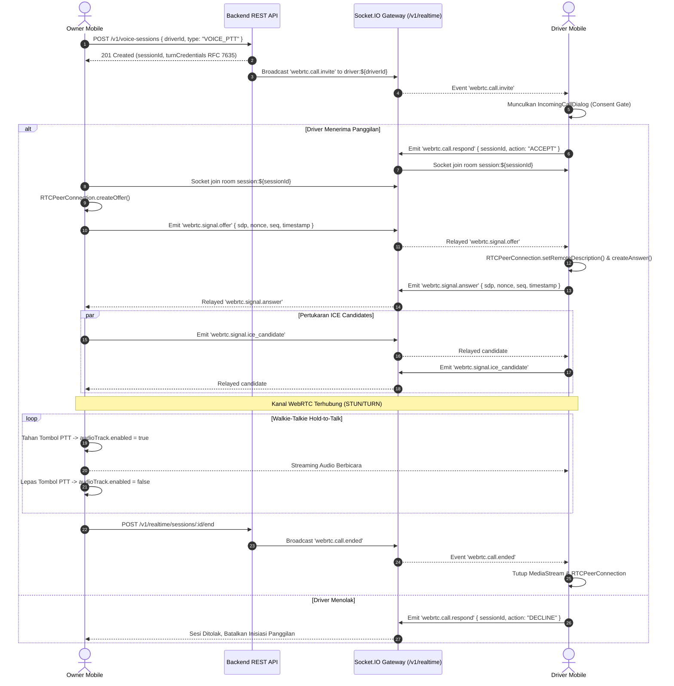

# Spesifikasi Teknis: Real Backend Wiring & Production Implementation (Armada Mobile)

**Dokumen:** Spesifikasi Arsitektur & Teknis Integrasi Penuh Backend  
**ID Dokumen:** `SPEC-FE-MOB-2026-11-12-REAL-WIRING`  
**Target Repositori:** `armadamobile` (`/home/priz/Documents/armadamobile`)  
**Backend Source of Truth:** `be-distribution-system-armada` (`/home/priz/Documents/be-distribution-system-armada`, NestJS 10, PostgreSQL PostGIS, Redis 7, Socket.IO Gateway)  
**Tanggal:** 12 November 2026  
**Status:** DRAFT SPECIFICATION FOR REVIEW  
**Penulis:** Lead Mobile Software Engineer (Flutter)

---

## 1. Ringkasan Eksekutif & Hasil Audit Kesenjangan (Gap Audit)

Aplikasi mobile **Armada Distribution System** (`armadamobile`) telah memiliki arsitektur dasar Provider, client Dio, Socket.IO, dan kanvas OpenStreetMap. Namun, berdasarkan audit menyeluruh terhadap kode sumber aktual dan komparasi langsung ke runtime NestJS backend (`be-distribution-system-armada`), ditemukan **5 Kesenjangan Kritis (Critical Gaps)** di mana antarmuka mobile masih menggunakan stub lokal, data mock/hardcoded, atau belum terhubung secara penuh ke backend:

```
┌─────────────────────────────────────────────────────────────────────────────────────────┐
│ TEMUAN AUDIT KESENJANGAN (GAP AUDIT) PADA KODE AKTUAL                                   │
├───────┬───────────────────────────────────┬─────────────────────────────────────────────┤
│ GAP 1 │ Delivery Order Creation           │ CreateDeliveryModalSheet.onSubmit hanya      │
│       │ (POST /v1/deliveries)             │ memanggil fetchAllData(), tidak pernah      │
│       │                                   │ memanggil _apiService.createDelivery()!     │
├───────┼───────────────────────────────────┼─────────────────────────────────────────────┤
│ GAP 2 │ Fleet Assignment                  │ AssignDriverModalSheet.onAssign hanya       │
│       │ (POST /v1/deliveries/:id/assign)  │ melakukan setState() lokal, tidak pernah    │
│       │                                   │ mengirim mutasi penugasan ke backend!       │
├───────┼───────────────────────────────────┼─────────────────────────────────────────────┤
│ GAP 3 │ Route Geometry & 2-Opt OSRM       │ Metrik jarak/durasi di RouteOptimizerSheet   │
│       │ (GET/POST .../routes/*)           │ hardcoded (14500m/2100s), polyline di driver│
│       │                                   │ berupa garis lurus, SelectRouteDto schema   │
│       │                                   │ tidak cocok dengan class-validator BE!      │
├───────┼───────────────────────────────────┼─────────────────────────────────────────────┤
│ GAP 4 │ Two-Way E2EE Chat & Inbox         │ Driver tidak memiliki entry point chat,     │
│       │ (GET/POST /v1/conversations/*)    │ ID percakapan di Owner di-hardcode          │
│       │                                   │ ('conv-${item.id}'), tidak ada Inbox screen │
├───────┼───────────────────────────────────┼─────────────────────────────────────────────┤
│ GAP 5 │ Real Field WebRTC Voice PTT &     │ flutter_webrtc belum terpasang, tombol PTT  │
│       │ Video Calling                     │ hanya animasi UI (tanpa audio track nyata), │
│       │ (Signaling WebSocket & Turn RFC)  │ payload sinyal WS menolak anti-replay BE.   │
└───────┴───────────────────────────────────┴─────────────────────────────────────────────┘
```

Dokumen spesifikasi ini menyusun desain rekayasa sistem untuk menutup kelima celah tersebut secara tuntas, mengubah simulasi menjadi fungsionalitas nyata tingkat produksi (*production-grade*).

---

## 2. Acuan Sumber Kebenaran & Standar Kontrak Backend

Seluruh integrasi wajib tunduk pada runtime NestJS yang diaudit pada repositori `be-distribution-system-armada`:

### 2.1 Konvensi Jaringan & Transport
- **Base URL REST API (Local Dev):** `http://localhost:3000/v1`
- **Base URL REST API (Production):** `https://armada-api.prizftm.my.id/v1`
- **Base URL Realtime Gateway (Local Dev):** `ws://localhost:3000/v1/realtime`
- **Base URL Realtime Gateway (Production):** `wss://armada-api.prizftm.my.id/v1/realtime` (Namespace: `/v1/realtime`)
- **Format Respons Sukses Standar:**
  ```json
  {
    "success": true,
    "data": { ... },
    "timestamp": "2026-11-12T08:00:00.000Z",
    "requestId": "e92409bd-1e94-474c-91c7-f9ad13fc98e7"
  }
  ```
- **Format Respons Error Standar:**
  ```json
  {
    "success": false,
    "error": {
      "code": "MACHINE_READABLE_CODE",
      "message": "Human readable error description",
      "requestId": "e92409bd-1e94-474c-91c7-f9ad13fc98e7"
    },
    "timestamp": "2026-11-12T08:00:00.000Z"
  }
  ```

---

## 3. Spesifikasi Arsitektur Domain & Resolusi Kesenjangan

### 3.1 Domain 1: Pembuatan Pengiriman Nyata (Real Delivery Creation)

#### A. Analisis Kesenjangan Aktual
Pada `lib/features/owner/views/owner_deliveries_view.dart`:
```dart
// KODE SAAT INI (STUB/GAP):
builder: (_) => CreateDeliveryModalSheet(
  onSubmit: (CreateDeliveryDto dto) async {
    await fleet.fetchAllData(); // BUG: Data DTO dibuang! Tidak pernah dikirim ke backend!
    ...
  },
)
```
Akibatnya, formulir pembuatan DO baru yang telah diisi oleh Owner tidak pernah disimpan ke database PostgreSQL backend, dan pesanan baru tidak pernah diterbitkan.

#### B. Desain Solusi Rekayasa
1. Memperluas `FleetProvider` dengan metode mutasi:
   ```dart
   Future<DeliveryModel> createDelivery(CreateDeliveryDto dto) async {
     _isLoading = true;
     notifyListeners();
     try {
       final newDelivery = await _apiService.createDelivery(dto);
       _deliveries.insert(0, newDelivery);
       _isLoading = false;
       notifyListeners();
       return newDelivery;
     } catch (e) {
       _isLoading = false;
       _errorMessage = 'Gagal menerbitkan DO: $e';
       notifyListeners();
       rethrow;
     }
   }
   ```
2. Mengaitkan `CreateDeliveryModalSheet.onSubmit` di `owner_deliveries_view.dart` agar memanggil:
   ```dart
   onSubmit: (CreateDeliveryDto dto) async {
     final created = await fleet.createDelivery(dto);
     if (context.mounted) {
       ScaffoldMessenger.of(context).showSnackBar(
         SnackBar(
           content: Text('Surat Jalan ${created.orderNumber} berhasil diterbitkan!'),
           backgroundColor: AppTheme.statusSuccess,
         ),
       );
     }
   }
   ```
3. Backend Kontrak: `POST /v1/deliveries`
   - Headers: `Authorization: Bearer <token>`
   - Body: `CreateDeliveryDto` (`deliveryCode`, `customerName`, `notes`, `plannedStartAt`, `items`, `stops`).
   - Respon Status: `201 Created`.

---

### 3.2 Domain 2: Penugasan Armada Nyata (Real Fleet Assignment)

#### A. Analisis Kesenjangan Aktual
Pada `lib/features/owner/views/owner_delivery_detail_view.dart`:
```dart
// KODE SAAT INI (STUB/GAP):
onAssign: (AssignDeliveryDto dto) async {
  final assignedDriver = fleet.drivers.firstWhere(...);
  setState(() {
    _currentDelivery = _currentDelivery.copyWith(
      status: 'ASSIGNED',
      assignedDriver: assignedDriver.driverName,
      plateNumber: assignedDriver.plateNumber ?? 'B 1234 SXZ',
    );
  });
  // BUG: Mutasi hanya di memori lokal view, tidak pernah mengirim POST ke backend!
}
```

#### B. Desain Solusi Rekayasa
1. Memperluas `FleetProvider` dengan metode penugasan resmi:
   ```dart
   Future<void> assignDelivery(String deliveryId, AssignDeliveryDto dto) async {
     await _apiService.assignDelivery(deliveryId, dto);
     // Update lokal cache dan trigger penyegaran data
     final idx = _deliveries.indexWhere((d) => d.id == deliveryId);
     if (idx != -1) {
       _deliveries[idx] = _deliveries[idx].copyWith(status: 'ASSIGNED');
     }
     notifyListeners();
   }
   ```
2. Mengaitkan callback `onAssign` di `owner_delivery_detail_view.dart`:
   - Menampilkan loading overlay/indikator selama proses mutasi jaringan.
   - Mengirim request ke backend via `fleet.assignDelivery(_currentDelivery.id, dto)`.
   - Menangkap error `ConflictException` (misal kapasitas muatan melebihi batas atau status pengiriman tidak valid) dan menampilkan pesan kesalahan ramah pengguna.
3. Backend Kontrak: `POST /v1/deliveries/:id/assign`
   - Body: `{"driverId": "<UUID>", "vehicleId": "<UUID>"}`
   - Status: `200 OK`
   - Backend memicu broadcast event `delivery.status_changed` ke room WebSocket `delivery:<id>` dan `fleet:monitoring`.

---

### 3.3 Domain 3: Optimasi Rute OSRM Nyata & Geometri Polyline (Real 2-Opt Routing)

#### A. Analisis Kesenjangan Aktual
1. **Model DTO Tidak Kompatibel**:
   - Backend `SelectRouteDto` (`select-route.dto.ts`) secara ketat mewajibkan:
     ```ts
     source: RouteSource; // 'RECOMMENDED_2OPT' | 'MANUAL' | 'EXTERNAL_OSRM'
     recommendedSequence: string[]; // ARRAY OF UUIDs!
     totalDistanceMeters: number;
     estimatedDurationSeconds: number;
     ```
   - Namun antarmuka Flutter saat ini mengirimkan array objek `[{sequence: 1, name: '...'}]` sehingga request `POST /v1/deliveries/:id/routes/select` ditolak oleh `class-validator` backend!
2. **Data Metrik Hardcoded**:
   - `owner_delivery_detail_view.dart` dan `owner_fleet_view.dart` memasukkan angka statis: `currentDistanceM: 14500`, `recommendedDistanceM: 12000`.
3. **Polyline Garis Lurus (Straight-line Waypoint)**:
   - `driver_tracking_view.dart` hanya menghubungkan koordinat GPS driver dan titik toko dengan garis lurus tanpa memanggil `GET /v1/deliveries/:id/routes/current` untuk mendapatkan geometri jalan raya sesungguhnya (*road-following polyline*).

#### B. Desain Solusi Rekayasa
1. **Penyelarasan DTO Kritis**:
   Memperbarui `lib/data/models/route_geometry_model.dart`:
   ```dart
   class SelectRouteDto {
     final String source; // 'RECOMMENDED_2OPT'
     final List<String> recommendedSequence; // Array UUID stop ID
     final double totalDistanceMeters;
     final int estimatedDurationSeconds;
     final String? idempotencyKey;

     Map<String, dynamic> toJson() => {
       'source': source,
       'recommendedSequence': recommendedSequence,
       'totalDistanceMeters': totalDistanceMeters,
       'estimatedDurationSeconds': estimatedDurationSeconds,
       if (idempotencyKey != null) 'idempotencyKey': idempotencyKey,
     };
   }
   ```
2. **Pemuatan Metrik Rekomendasi Dinamis**:
   - Sebelum menampilkan `RouteOptimizerSheet`, panggil `_apiService.getRecommendedRoute(deliveryId, provider: 'osrm')`.
   - Mengurai respon aktual:
     * `totalDistanceMeters`: jarak hasil kalkulasi 2-Opt.
     * `estimatedDurationSeconds`: durasi tempuh estimasi OSRM.
     * `recommendedSequence`: urutan UUID stop toko optimal.
     * `polylineGeojson`: koordinat geometri jalan raya baru.
3. **Konversi Geometri GeoJSON RFC 7946**:
   - Backend OSRM mengembalikan koordinat berformat `[longitude, latitude]`.
   - Parser Flutter secara ketat membalik urutan:
     ```dart
     final lat = (coord[1] as num).toDouble();
     final lng = (coord[0] as num).toDouble();
     points.add(LatLng(lat, lng));
     ```
4. **Rendering Polyline Mengikuti Jalan Raya**:
   - `driver_tracking_view.dart` dan `owner_fleet_view.dart` memanggil `getCurrentDeliveryRoute(deliveryId)`. Jika geometri OSRM tersedia, render jalur presisi jalan raya di atas OpenStreetMap.

---

### 3.4 Domain 4: Obrolan Dua Arah E2EE & Kotak Masuk Percakapan (Real Two-Way Chat & Inbox)

#### A. Analisis Kesenjangan Aktual
1. Tidak ada daftar percakapan terpadu (*Conversation Inbox*) untuk Driver maupun Owner.
2. Driver di `driver_home_view.dart` dan `driver_shell.dart` tidak memiliki akses tombol navigasi ke modul percakapan.
3. Di `owner_delivery_detail_view.dart`, ID percakapan di-generate lokal sebagai `'conv-${item.id}'`, yang melanggar kontrak backend karena ID percakapan di backend adalah UUID v4 independen hasil relasi `(ownerId, driverId)`.
4. Enkripsi `SendMessageDto` mengirimkan `recipientDeviceId` dummy `'dev-target-default'`, padahal backend memvalidasi keberadaan `recipientDeviceId` di tabel `devices`.

#### B. Desain Solusi Rekayasa
1. **Layar Kotak Masuk Percakapan (`ConversationInboxView`)**:
   - Mengambil daftar percakapan aktif dari `GET /v1/conversations`.
   - Menampilkan lawan bicara (Nama Driver & Nomor Plat untuk Owner, atau Nama Dispatcher/Owner untuk Driver), cuplikan pesan terakhir (*preview*), waktu pengiriman, dan badge pesan belum dibaca (*unread count*).
2. **Penyambungan Jalur Navigasi Lengkap**:
   - Driver: Menambahkan tab navigasi "Pesan / Chat" atau ikon AppBar di `driver_shell.dart` dan `driver_home_view.dart`.
   - Owner: Menambahkan akses pesan di `owner_shell.dart` dan tombol "Chat Driver" di `owner_delivery_detail_view.dart`.
3. **Resolusi Percakapan Kanonikal**:
   - Saat Owner menekan "Chat Driver", panggil `POST /v1/conversations` dengan payload `{"driverId": driverId}`.
   - Backend melakukan `upsert` dan mengembalikan UUID percakapan resmi.
   - Buka `ChatConversationView(conversation: conversation)`.
4. **Resolusi Perangkat Penerima (`recipientDeviceId`)**:
   - Panggil `GET /v1/devices/my-devices` atau ambil target device ID aktif dari metadata percakapan/profil driver.
   - Jika belum terdaftar, gunakan fallback ID perangkat aktif pertama yang terotentikasi.
5. **Siklus Hidup Pesan Realtime**:
   - Mengirim pesan via WebSocket `chat.message.send` (atau REST fallback `POST /v1/conversations/:id/messages`).
   - Menerima event `chat.message.relayed` di room `conversation:<id>` $\rightarrow$ otomatis dekripsi AES-256 dan render seketika ke bubble chat.
   - Menerima event `chat.message.ack` $\rightarrow$ perbarui centang status pengiriman (`SENT`).

---

### 3.5 Domain 5: WebRTC Voice PTT & Video Calling Nyata (Real Audio/Video Track Pipeline)

#### A. Analisis Kesenjangan Aktual
1. Package `flutter_webrtc` dan `permission_handler` belum terpasang di `pubspec.yaml`.
2. Tombol `PttWalkieTalkieButton` saat ini hanya berupa animasi visual `Transform.scale` tanpa menangkap audio mikrofon nyata.
3. Handler WebSocket untuk sinyal WebRTC (`sendWebrtcOffer`, `sendWebrtcAnswer`, `sendWebrtcIceCandidate`) saat ini memancarkan payload yang tidak memiliki `nonce`, `seq`, dan `timestamp`. Backend NestJS `WebrtcAntiReplay` akan menolak sinyal tersebut dengan error `REPLAY_DETECTED` atau `CLOCK_SKEW_EXCEEDED`!
4. Driver belum memiliki listener aktif terhadap event ajakan panggilan `webrtc.call.invite` di `DriverShell`.

#### B. Desain Solusi Rekayasa
1. **Pemasangan Dependensi & Izin Native**:
   - `pubspec.yaml`:
     ```yaml
     flutter_webrtc: ^0.12.5
     permission_handler: ^11.4.0
     ```
   - `android/app/src/main/AndroidManifest.xml`:
     ```xml
     <uses-permission android:name="android.permission.RECORD_AUDIO" />
     <uses-permission android:name="android.permission.CAMERA" />
     <uses-permission android:name="android.permission.MODIFY_AUDIO_SETTINGS" />
     <uses-permission android:name="android.permission.BLUETOOTH" />
     <uses-feature android:name="android.hardware.camera" android:required="false" />
     <uses-feature android:name="android.hardware.camera.autofocus" android:required="false" />
     ```
2. **Kepatuhan Sinyal Anti-Replay Backend**:
   Memperbarui payload sinyal di `SocketRealtimeService` agar menyertakan atribut `WebrtcSignalingBaseDto`:
   ```dart
   int _webrtcSeq = 1;

   void sendWebrtcOffer(String sessionId, String sdp) {
     _socket?.emit('webrtc.signal.offer', {
       'sessionId': sessionId,
       'sdp': sdp,
       'nonce': const Uuid().v4(),
       'seq': _webrtcSeq++,
       'timestamp': DateTime.now().millisecondsSinceEpoch,
     });
   }
   ```
3. **WebRTC Media Manager Service (`WebRtcService`)**:
   - Mengelola `RTCPeerConnection` dengan konfigurasi IceServer dari `TurnCredentialsModel` (RFC 7635).
   - Inisialisasi media stream lokal (`navigator.mediaDevices.getUserMedia(...)`).
   - Mode PTT Suara: Membuka track audio. Secara default, `audioTrack.enabled = false`. Saat tombol Walkie-Talkie ditahan (*press-down*), set `audioTrack.enabled = true` (transmisi suara). Saat dilepas (*release-up*), set `audioTrack.enabled = false`.
   - Mode Video: Membuka track kamera dan audio dengan renderer `RTCVideoView`.
4. **Alur Panggilan Masuk Driver (Driver Consent Gate)**:
   - `DriverShell` mendengarkan `socketService.callInviteStream` (event `webrtc.call.invite`).
   - Memunculkan `IncomingCallDialog` yang menampilkan identitas penelepon.
   - Jika Driver memilih "Terima" (`ACCEPT`):
     * Kirim `POST /v1/realtime/sessions/:id/respond` atau emit WS `webrtc.call.respond` (`action: ACCEPT`).
     * Driver bergabung ke room `session:<id>`.
     * Membuka layar panggilan aktif `WebRtcCallScreen`.
   - Jika Driver memilih "Tolak" (`DECLINE`):
     * Kirim respons penolakan dan tutup dialog tanpa membuka kamera/mikrofon (**Review Focus #5 terpenuhi**).

---

## 4. Diagram Alur Sistem End-to-End (Mermaid)

### 4.1 Alur Siklus Hidup WebRTC PTT Walkie-Talkie & Signaling



---

## 5. Matriks Penanganan Error & Ketahanan Jaringan

| Skenario Kegagalan | Respon Backend | Penanganan Klien Mobile |
| :--- | :---: | :--- |
| **Kapasitas Kendaraan Overload** saat penugasan | `400 / 409 Conflict` | Memblokir tombol kirim di modal sheet dan menampilkan banner merah peringatan daya angkut kargo. |
| **Stop ID Bukan Milik Delivery** saat seleksi rute | `422 Unprocessable` | Hanya mengirim array UUID yang valid dari daftar stop toko delivery terkait. |
| **Sinyal WebRTC Terlambat / Replay** | `400 CLOCK_SKEW_EXCEEDED` | Sinkronisasi timestamp perangkat dan pembuatan nonce UUID baru untuk setiap frame sinyal. |
| **Panggilan Tak Terjawab (30 detik)** | `status: TIMEOUT` | Watchdog timer menutup modal panggilan dan menampilkan snackbar "Panggilan tidak terjawab". |
| **Koneksi Seluler Terputus (Blank Spot)** | Timeout / Socket Drop | Otomatis memasukkan mutasi status ke `LocalOutboxService` dan melakukan auto-flush begitu internet tersambung kembali. |

---

## 6. Standar Ergonomi UI/UX Pro Max

- **Touch Target Minimum:** Seluruh kontrol aksi lapangan (tombol konfirmasi penugasan, tombol kirim pesan chat, dan tombol mikrofon PTT) memiliki luas sentuh $\ge 48 \times 48\text{ dp}$.
- **One-Thumb Rule:** Tombol PTT ditempatkan di 40% area bawah layar untuk kenyamanan pengoperasian satu tangan saat driver mengemudi.
- **Kontras Aksesibilitas:** Rasio kontras teks utama dan status badge $\ge 4.5:1$ (memenuhi standar WCAG AA) untuk visibilitas di bawah terik matahari.
